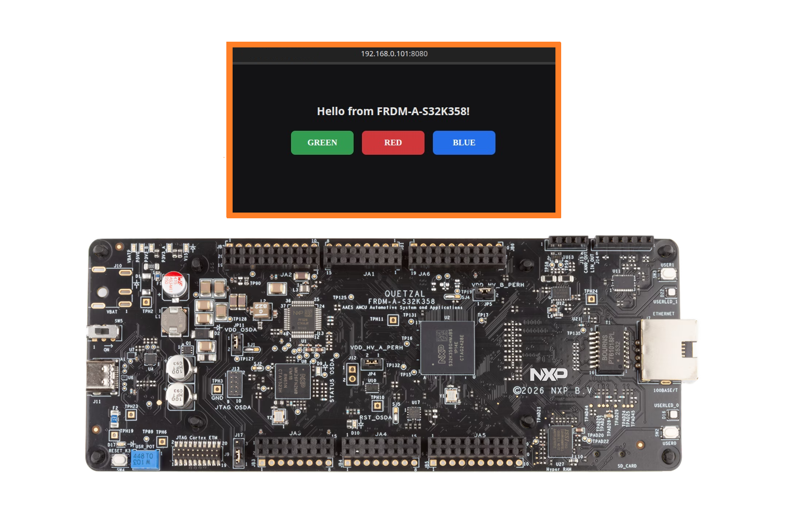
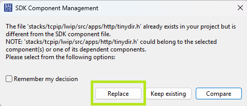
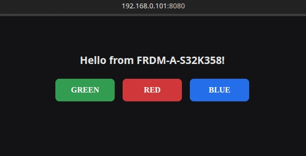

# NXP Application Code Hub

## LWIP HTTP LED Control
This demo showcases a simple HTTP-based LED control application running on the FRDM-A-S32K358 board using the AUTOSAR MCAL Ethernet drivers and the lwIP TCP/IP stack. A lightweight web server hosts a webpage containing three buttons, each associated with one of the onboard RGB LEDs. When a button is pressed from a web browser, the corresponding HTTP request is processed by the application and translated into GPIO control commands through the MCAL GPIO driver. The selected LED is then activated in real time, demonstrating Ethernet connectivity, HTTP server functionality, and browser-based interaction with the MCU hardware.
[

](./images/FRDM-A-S32K358_WebPage.png)

#### Boards: FRDM-A-S32K358
#### Categories: Networking
#### Peripherals: ETHERNET, GPIO
#### Toolchains: S32 Design Studio IDE

## Table of Contents
1. [Software and Tools](#step1)
2. [Hardware](#step2)
3. [Setup](#step3)
4. [Results](#step4)
5. [Support](#step6)
6. [Release Notes](#step7)

## 1. Software and Tools
### 1.1 FRDM Automotive Bundle for S32K3
This example was developed using the FRDM Automotive Bundle for S32K3 + S32M27. To download and install the complete software and tools ecosystem, use the following link:
- [ FRDM Automotive S32K3 + S32M27 Board Installation Package](https://www.nxp.com/app-autopackagemgr/automotive-software-package-manager:AUTO-SW-PACKAGE-MANAGER?currentTab=0&selectedDevices=S32K3&applicationVersionID=203)

## 2. Hardware
### 2.1 Required Hardware
- Personal Computer
- Type-C USB cable
- UTP/FTP CAT 5e Ethernet cable
- [FRDM-A-S32K358](https://www.nxp.com/design/design-center/development-boards-and-designs/FRDM-A-S32K358)

### 2.2 Debugger Connection
- Connect the Type-C USB cable to PC and FRDM-A-S32K358 board for power supply and debugging
- Connect the Ethernet cable directly between the PC and the FRDM-A-S32K358 board.

## 3. Setup

### 3.1 Import the Project into S32 Design Studio IDE
1. Open S32 Design Studio IDE, in the Dashboard Panel, choose **Import project from Application Code Hub**.
[

](./images/import_project_1.png)

2. Find the demo you need by searching for the name directly. 
Open the project, click on the **GitHub link** from this window, S32 Design Studio IDE will automatically retrieve project attributes, then click **Next>**.
[

](./images/import_project_3.png)

3. Select **main** branch and then click **Next>**.
4. Select your local path for the repo in **Destination->Directory** window. The S32 Design Studio IDE will clone the repo into this path, click **Next>**.

5. Select **Import existing Eclipse projects** then click **Next>**.

6. Select the project in this repo (only one project in this repo) then click **Finish**.
### 3.2 Generating, Building and Running the Example
1. In Project Explorer, right-click the project and select **Update Code and Build Project**. This will generate the configuration (Pins, Clocks, Peripherals), update the source code and build the project using the active configuration (e.g. Debug_FLASH).
Make sure the build completes successfully and the *.elf file is generated without errors.
[

](./images/update_and_build.png)
Press **Yes** in the **SDK Component Management** pop-up window to continue.

2. If a pop-up appears asking whether to replace or keep the existing TCPIP configuration files, make sure to select Replace. During the Update Code process, the tool scans the project for non-standard library functions and macros, such as MEMCPY, MEMSET, or other TCPIP stack abstractions. When newer generated TCPIP configuration files are imported, these macros may be updated to use the corresponding standard C library functions (for example, MEMCPY → memcpy()).

> Note: Selecting Replace ensures that all TCPIP configuration files remain synchronized with the latest generated code and expected macro definitions. Keeping the existing files may retain outdated settings or definitions that could lead to build issues or unexpected behavior after the update.

[

](./images/build_project_1.png)

3. Go to **Debug** and select **Debug Configurations**. There will be a debug configuration for this project:
[

](./images/Debug_config.png)

        Configuration Name                  Description
        -------------------------------     -----------------------
        $(example)_debug_flash_pemicro      Debug the FLASH configuration using PEmicro probe

    Select the desired debug configuration and click on **Debug**. Now the perspective will change to the **Debug Perspective**.
    Use the controls to control the program flow.

## 4. Results
Once the firmware is running and the board is connected to the PC via an Ethernet cable, the following behavior is expected:

[

](./images/web_page.png)

- It is recommended that your PC is on the same subnet as the MCU in order for the PC to MCU communication to work. The board responds at the IP address of `192.168.0.101` due to the configuration made in the LwIp stack.
- Open a web browser and navigate to **`http://192.168.0.101:8080`**. The on-board HTTP server serves a small control page containing **three buttons**, one for each of the on-board RGB LEDs.
- Pressing a button sends a request to the board that toggles the matching LED in real time:
  - **GREEN** button - toggles the **green** LED on the board.
  - **RED** button - toggles the **red** LED on the board.
  - **BLUE** button - toggles the **blue** LED on the board.
- Connectivity can be verified independently with `ping 192.168.0.101`, which returns successful ICMP replies.

## 5. Support
For general technical questions related to NXP microcontrollers, please use the *[NXP Community Forum](https://community.nxp.com/)*.

#### Project Metadata

<!----- Boards ----->

<!----- Categories ----->

<!----- Peripherals ----->

<!----- Toolchains ----->

Questions regarding the content/correctness of this example can be entered as Issues within this GitHub repository.

>**Note**: For more general technical questions regarding NXP Microcontrollers and the difference in expected functionality, enter your questions on the [NXP Community Forum](https://community.nxp.com/)

## 6. Release Notes
| Version | Description / Update                           | Date                          |
|:-------:|------------------------------------------------|------------------------------:|
| 1.0     | Initial release on Application Code Hub        | October 14nd 2026 |
